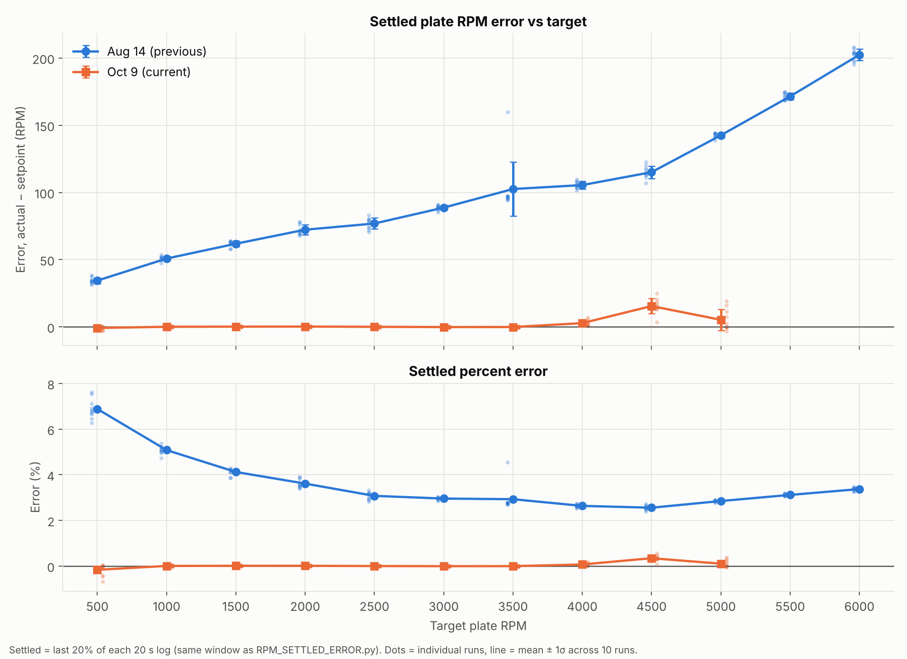

# Speed control: 2026-08-14 vs 2026-10-09

Compares speed control at each target RPM between a test on 2026-08-14 and one on 2026-10-09. Each target speed was
run 10 times (500-6000 RPM on 2026-08-14, 500-5000 RPM on 2026-10-09). Between the two tests, the firmware's feedback
controller gained an integral term (2026-09-30) and a derivative term (2026-10-03).

| | 2026-08-14 | 2026-10-09 |
|---|---|---|
| Steady-state error | +34 to +202 RPM (2.6-6.9% fast) | within 16 RPM (0.35% or less) |
| Settled within 1% | never | 0.9-1.4 s from 1000 RPM up, 14.5 s at 500 RPM |
| Overshoot | 2.7-29.6% | 0.8-1.8% from 1000 RPM up, 20.6% at 500 RPM |

TODO: plate RPM or motor RPM, firmware commits used for each test, and how the metrics were computed (script?).

## Files
- [comparison_summary_by_rpm.csv](comparison_summary_by_rpm.csv): averages per run date and target RPM
- [comparison_per_run_metrics.csv](comparison_per_run_metrics.csv): one row per test run
- Plots:
  - [settled error](CMP_01_settled_error.png)
  - [step responses](CMP_02_step_response_grid.png)
  - [transient metrics](CMP_03_transient_metrics.png)
  - [stability](CMP_04_stability.png)
  - [duty cycle](CMP_05_duty_cycle.png)
  - [encoder spikes](CMP_06_encoder_spikes.png)

