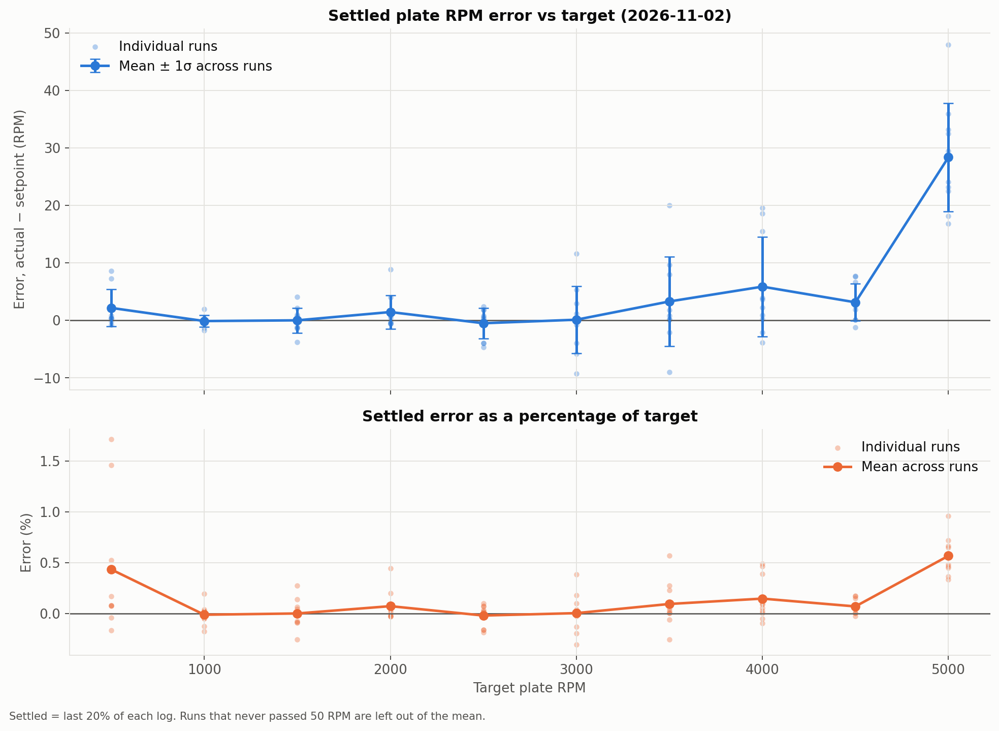
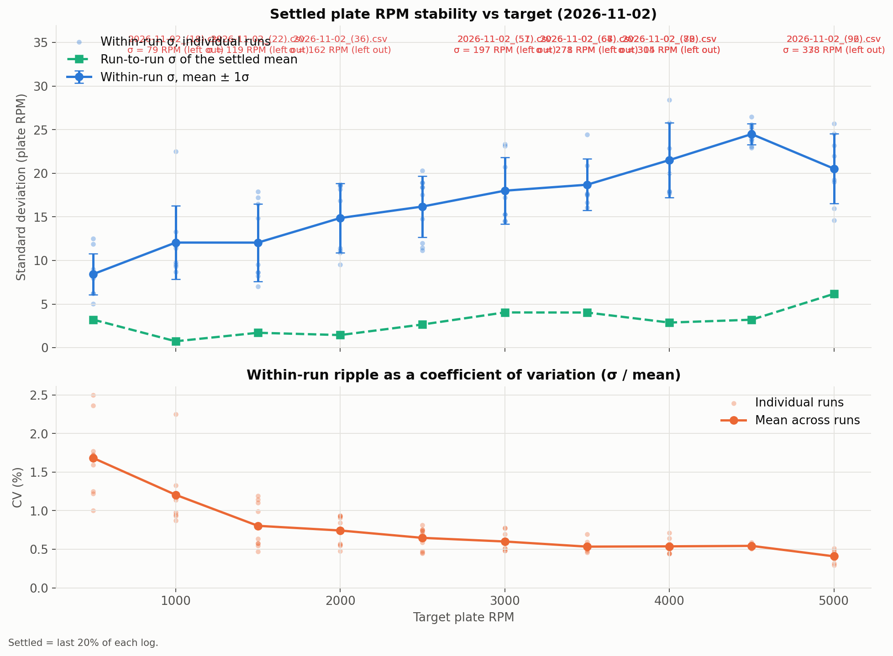
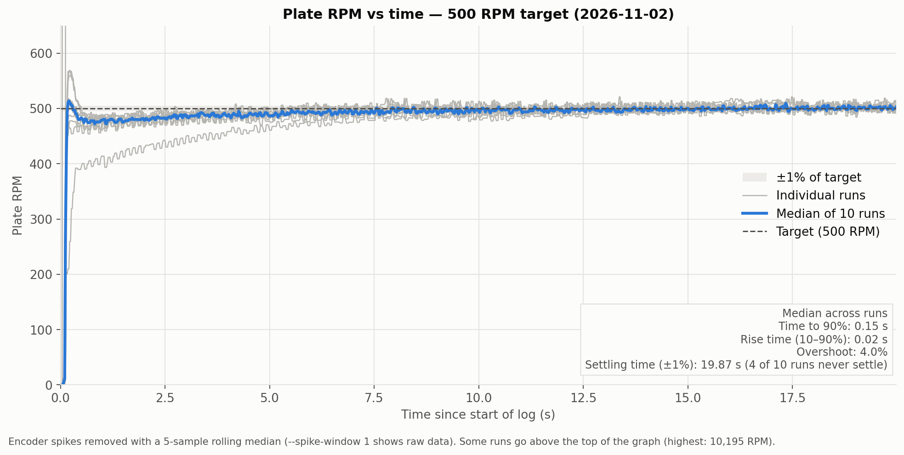
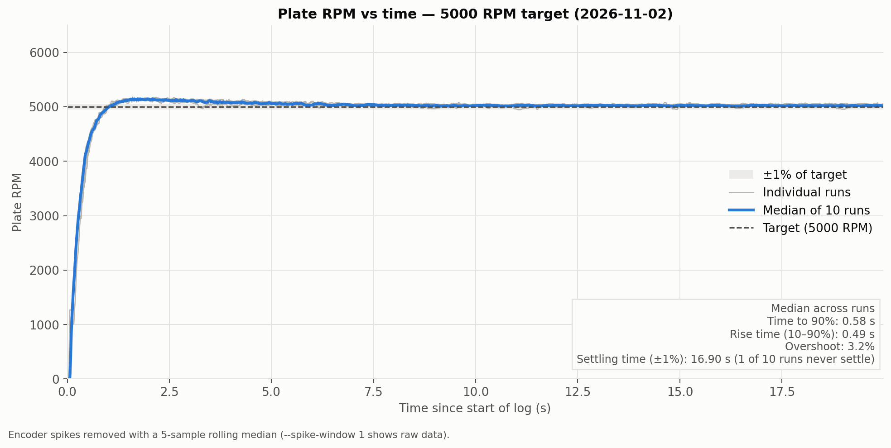

# Rolling average removal: 2026-11-02

Removing rolling averages was a significant change in our motor control. I (Anthony) previously used a rolling RPM average over 16 RPMs as our "current RPM" when calculating feedforward and feedback as well as logging. I did this to deal with the inherent noisiness of our RPM data, which I perceived as a lack of precision from the encoder. However, in hindsight I realize that this added a bias towards past RPM values and slowed down our PID controller's response time. It also meant that any RPM spikes to due encoder glitches made the RPM inaccurate for 16 whole loop iterations, which our PID controller reacted to by lowering the duty cycle a noticeable amount.
So I removed the rolling average and re-tuned the PID gains. Unfortunately, I was no longer able to use the Ziegler-Nichols method to tune the PID gains because the RPM data was too noisy to detect an oscillation. In addition, I had to remove the D gain because it reacted poorly to the RPM jitter and caused the duty cycle to jump around, making the RPM jitter even more. I hand-tuned the PID gains to the best of my ability, but the motor now overshoots slightly at the start of a single-RPM run.

Our motor control is now much more resilient to RPM spikes at the cost of being worse at reaching a stable RPM.

Git commit: [1575480...](https://github.com/irvinehackerfab/spincoater/commit/15754802851914236d8183267035d08ea83e27d9)

TODO: Should we commit the numpy code used to generate these graphs?

## Images

