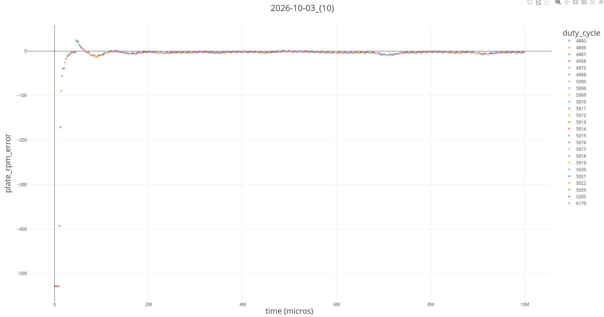
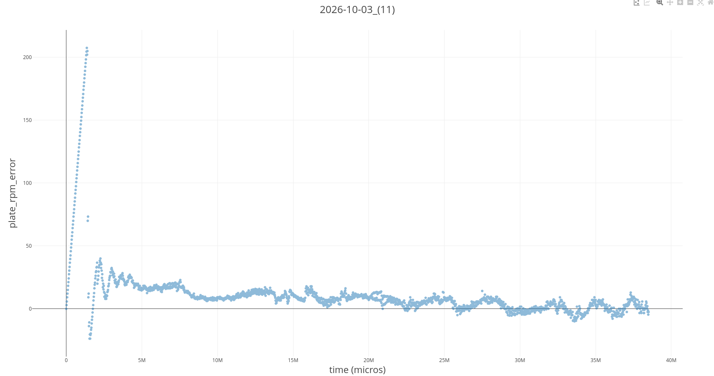
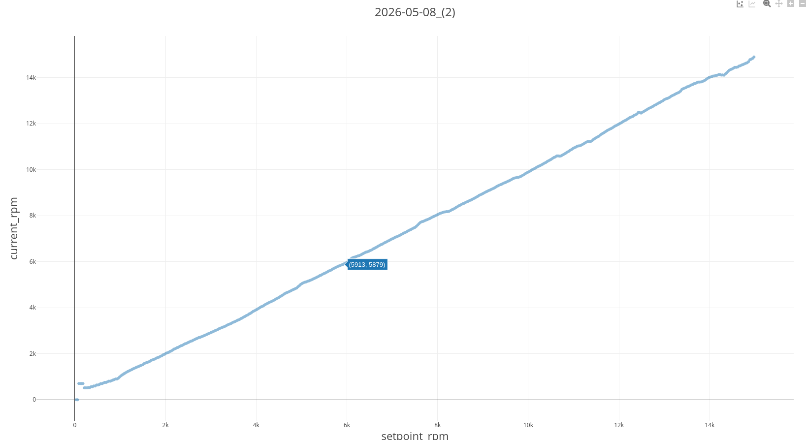
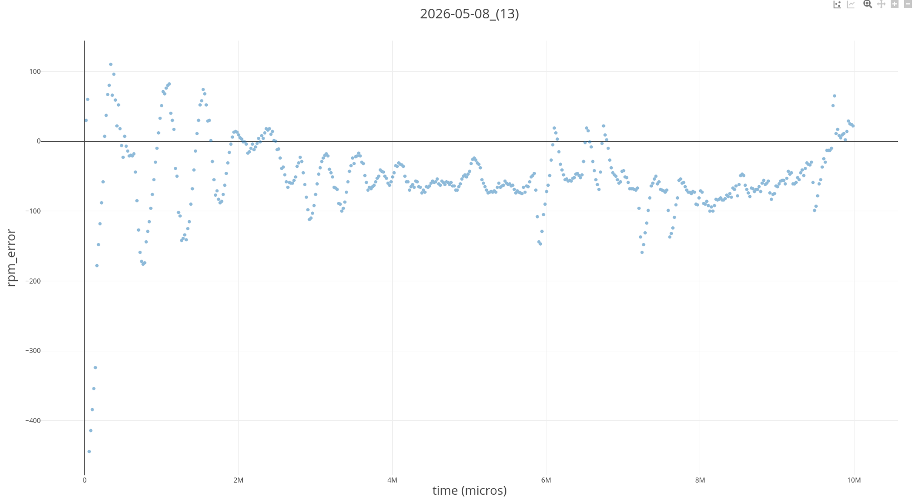

# Calibration

> [!WARNING]
> The controller and its constants are still being tuned, so the numbers here will change.

The ESC reads a 50 Hz PWM signal: a 7.5% duty cycle is neutral (stopped) and 10% is full power. The firmware has to
turn an RPM setpoint into a duty cycle in that range.

## How the firmware sets speed
1. A cubic equation turns the setpoint motor RPM into a starting duty cycle
   ([`cubic_conversion`](../code/rust/cross/esp32/src/gpio/pwm.rs)).
2. A feedback controller with proportional, integral and derivative terms corrects it using the RPM measured by
   the hall effect sensor ([`pid.rs`](../code/rust/cross/esp32/src/pid.rs)).

## Test results
The latest comparison, with 10 runs at each speed from 500 to 6000 RPM, is in
[data/2026-10-09-controller-comparison](../data/2026-10-09-controller-comparison).

Plate RPM error after adding the derivative term (2026-10-03), at several duty cycles and on a longer run:

| | |
|---|---|
|  |  |

### Older results
These are from May 2026, before the cubic model and the integral and derivative terms were added.

Setpoint vs measured RPM on a ramp (2026-05-08):

RPM error over a 10 second run (2026-05-08):

TODO: which firmware version and motion profile these runs used, and the raw logs in [data/](../data).

## Recalibrating
1. Run a ramp profile with [`host_tui`](../code/rust/host_tui) to log motor data.
2. Run [`linear_regression`](../code/rust/linear_regression) on the log to get new constants.

TODO: how the current cubic coefficients were fitted, and where to paste new ones.
