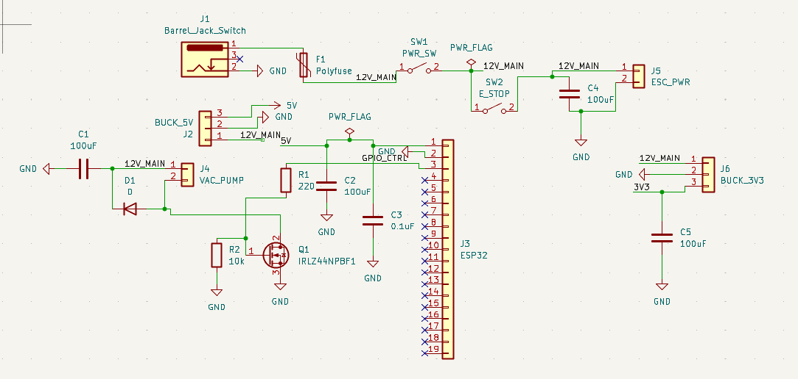
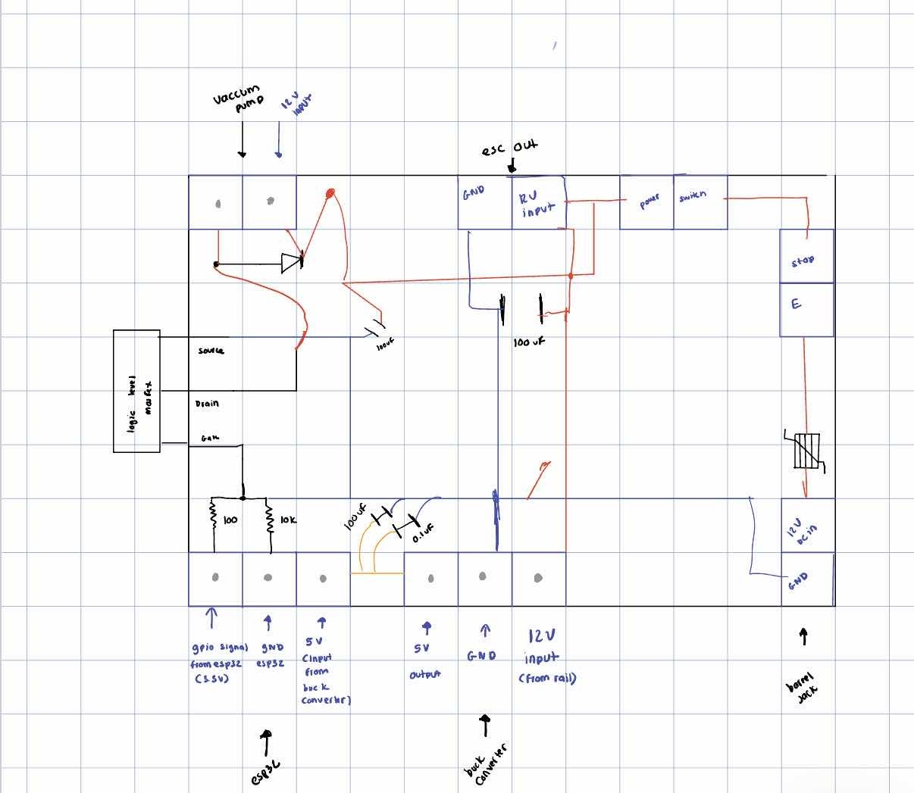
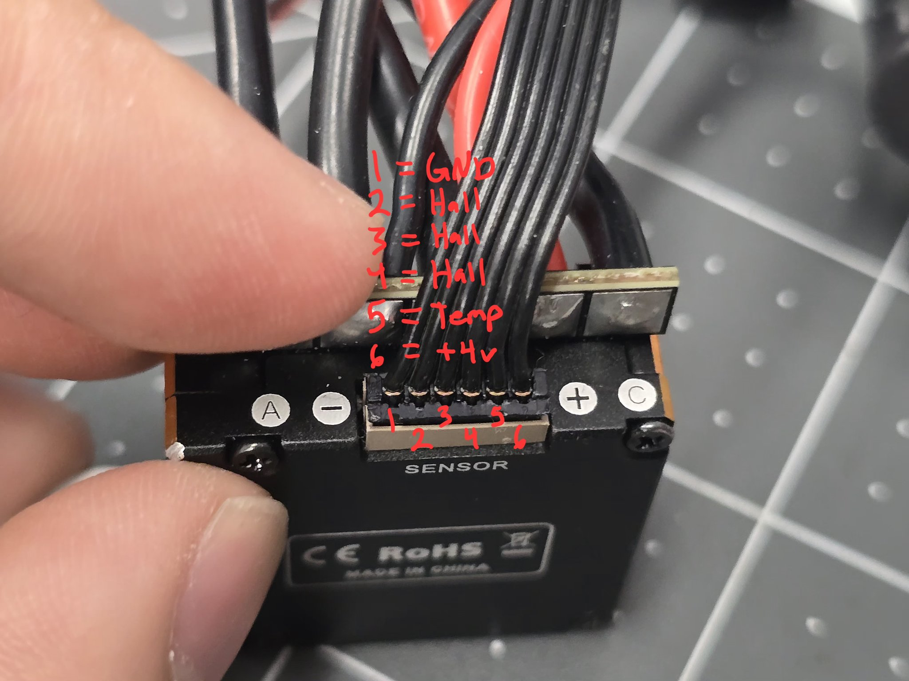
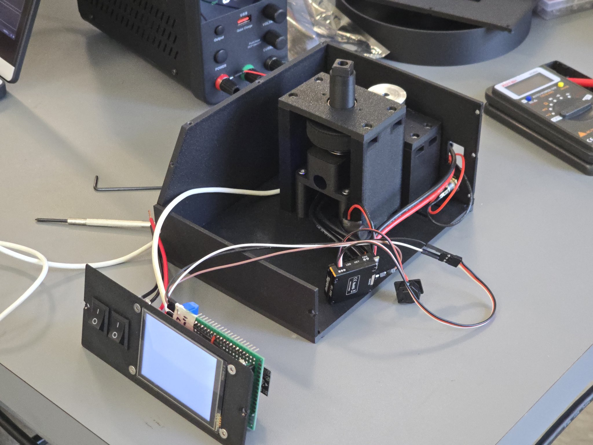
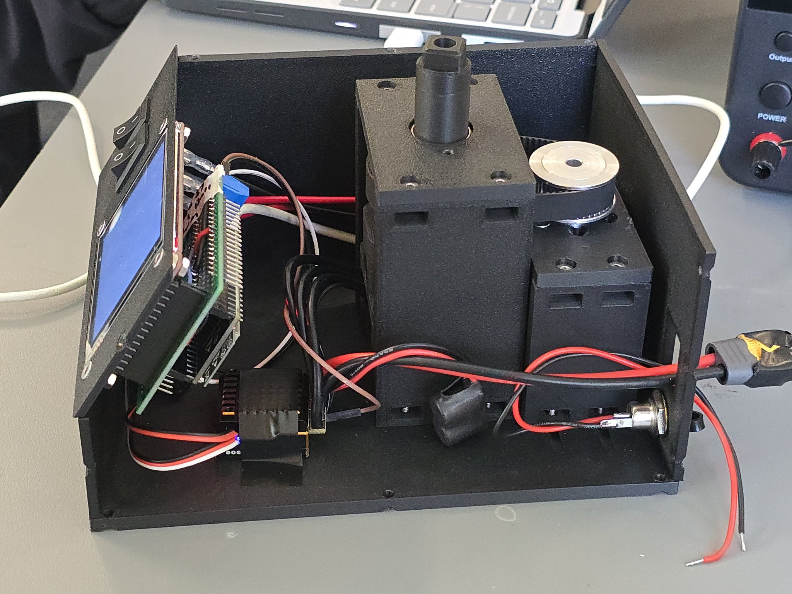
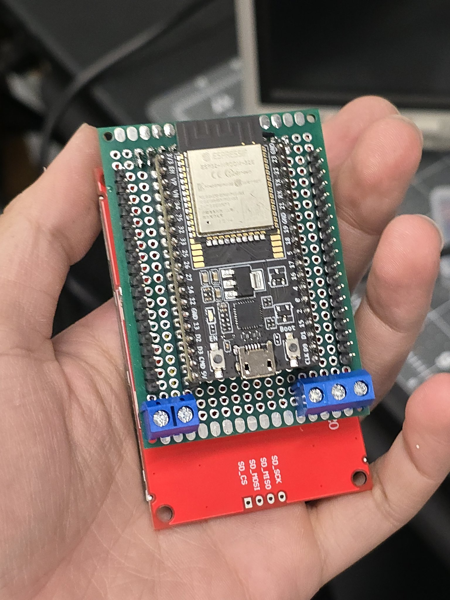
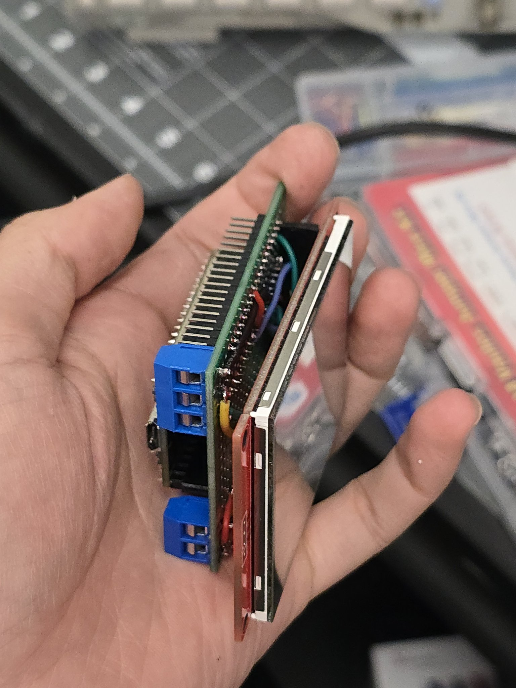

# Wiring

> [!WARNING]
> The electronics are still changing. These diagrams are drafts and may not match the current build.

The ESP32 pin layout is kept with the firmware so it stays in sync with the code:
[code/rust/cross/esp32/README.md](../code/rust/cross/esp32/README.md#pin-layout).

## Power board
Everything runs from a 12V 10A adapter. A buck converter steps it down to 5V for the ESP32, and an IRLZ44N MOSFET
switches the 12V vacuum pump from an ESP32 GPIO pin. The ESC gets 12V through the power switch and the E-stop.

Schematic:

Hand-drawn perfboard layout:

TODO: which of these two matches the current build.

## ESC sensor port

## Inside the enclosure
| | |
|---|---|
|  |  |
|  |  |

## Connections
TODO: ESC, motor, hall effect sensor, vacuum pump, touchscreen and the PC/UART connection.
